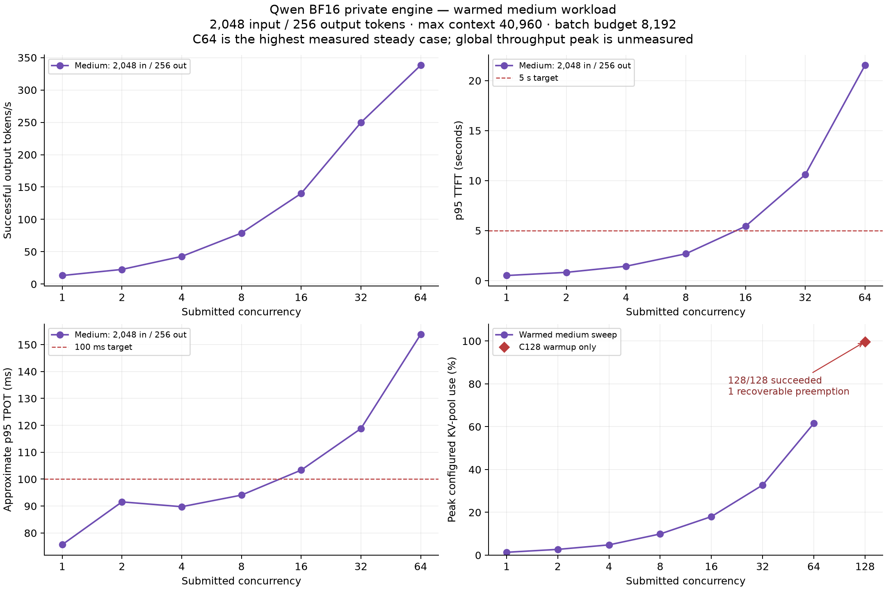
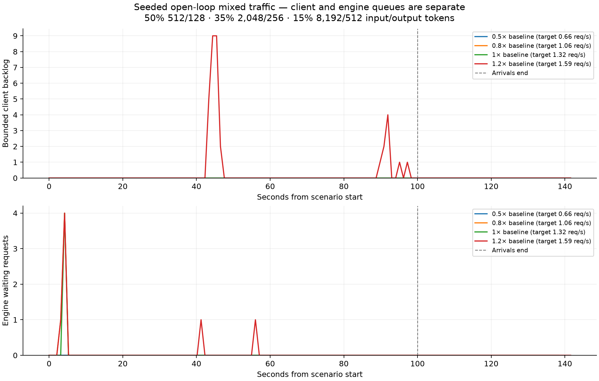

# Qwen BF16 capacity test — November 11, 2026

Final restoration verified.

Highest tested passing concurrency: **32 for short (512/128 tokens), 8 for medium (2048/256 tokens)**. The common short/medium envelope is **8 active requests**.

This measures the private base-text vLLM engine, bypassing the gateway. It does
not establish website capacity or authorize changing gateway quotas. The tested
engine sequence ceiling was 256 and batched-token budget 8192; these are the only
engine settings tested, not demonstrated optimal values.

## Configuration and method

- GPU: one NVIDIA RTX PRO 6000 Blackwell Server Edition, 97,887 MiB reported VRAM.
- vLLM 0.32.0; BF16; context limit 40,960; GPU memory utilization 0.90; CPU offload 0;
  eager execution retained. Existing image/LoRA allocation and multimodal settings
  remained loaded; inference used only the base text alias.
- Model: `Qwen/Qwen3.8-27B`, revision `1d4bf0f2ff6012fd82039f2fa52739d0dd7c60c0`.
- Image: `zihan000/qwen-inference@sha256:37c29b080780178ceeb2f9481118b7e46fd7f08f0371124ac7fca8533dc8473d`.
- Short 512/128, medium 2048/256, long 8192/512 exact input/output tokens. Seed 12345;
  thinking disabled; temperature 0; unique early prefixes and supported per-request
  cache salts. Stream usage verifies tokens; chunks are never treated as tokens.
- Continuous mode immediately replaces completed requests. Submitted outstanding
  work is hard-bounded at 1024; actual tested C never exceeds 128. Open-loop client
  backlog is separate from engine running/waiting counts.
- Latencies start at scheduled arrival, including client waiting. Each request has
  a 180 s wall deadline; stage/global deadlines can censor work. Every scheduled
  request has an outcome. Failures and cancellations remain in success denominators.
- Average TPOT is approximate: first-to-last content-chunk duration divided by
  usage output tokens minus one. Multi-token chunks can affect this approximation.
  Latency quantiles use successful requests.

## Warmed medium sweep

| Case | C | Outcomes | Success | Output tok/s | p95 TTFT (s) | Approx. p95 TPOT (ms) | p95 E2E (s) |
|---|---:|---:|---:|---:|---:|---:|---:|
| `medium-sweep-1` | 1 | 7 | 100.0% | 13.25 | 0.50 | 75.66 | 19.77 |
| `medium-sweep-2-retry2` | 2 | 10 | 100.0% | 22.68 | 0.82 | 91.56 | 24.11 |
| `medium-sweep-4-retry2` | 4 | 16 | 100.0% | 42.77 | 1.43 | 89.77 | 24.27 |
| `medium-sweep-8-retry2` | 8 | 32 | 100.0% | 78.93 | 2.68 | 94.07 | 26.36 |
| `medium-sweep-16-retry2` | 16 | 63 | 100.0% | 140.11 | 5.43 | 103.37 | 30.91 |
| `medium-sweep-32-retry2` | 32 | 96 | 100.0% | 249.70 | 10.60 | 118.80 | 40.02 |
| `medium-sweep-64-retry2` | 64 | 147 | 100.0% | 338.12 | 21.53 | 153.78 | 59.71 |

The C1 arrival window was 120 s; subsequent warmed cases used 90 s, followed by
drain. Throughput divides successful output tokens by complete scenario elapsed
time, including drain. The highest measured steady case is C64. Throughput was
still rising; this does not establish a global throughput peak or optimal knee.
C8 passed the latency thresholds provisionally; C16 exceeded both 5 s TTFT and
100 ms approximate TPOT. Intermediate concurrency values were not tested.

## Short/medium validation

| Case | C | Outcomes | Success | Output tok/s | p95 TTFT (s) | Approx. p95 TPOT (ms) | p95 E2E (s) |
|---|---:|---:|---:|---:|---:|---:|---:|
| `validate-medium-8-retry2` | 8 | 100 | 100.0% | 88.00 | 2.59 | 81.10 | 23.22 |
| `validate-short-8-retry2` | 8 | 100 | 100.0% | 92.10 | 0.79 | 82.40 | 11.25 |

A validated result requires at least 100 outcomes for both short and medium at
the same settings, success at least 99%, p95 TTFT at most 5 s, and approximate p95 TPOT
at most 100 ms. Smaller samples and budget-censored runs cannot establish capacity.

## Workload-specific boundary checks

| Case | C | Outcomes | Success | Output tok/s | p95 TTFT (s) | Approx. p95 TPOT (ms) | p95 E2E (s) |
|---|---:|---:|---:|---:|---:|---:|---:|
| `short-boundary-32-retry2` | 32 | 192 | 100.0% | 305.60 | 2.81 | 89.86 | 13.51 |
| `short-boundary-64-retry2` | 64 | 320 | 100.0% | 518.25 | 5.41 | 108.23 | 18.01 |
| `long-boundary-32-retry2` | 32 | 32 | 100.0% | 190.05 | 44.48 | 151.99 | 86.15 |
| `long-boundary-64-retry2` | 64 | 64 | 100.0% | 185.18 | 133.20 | 199.32 | 176.73 |

Short-only capacity differs from medium: short C32 meets the specified targets
with at least 100 successful outcomes, while short C64 exceeds the latency limits.
Medium C8 passed and C16 failed. Therefore 8 is the common tested envelope, not a
universal limit for every workload. Long requests are reported separately and
are not covered by the short/medium chat recommendation.

The long C32 and C64 cases each admitted one submitted wave (outcomes equal
concurrency).The 75 s arrival windows closed before any slot could refill; completion
and drain continued afterward. They are burst/boundary probes,
not steady long-workload capacity measurements. C32 versus C64 produced 190.05
versus 185.18 output tokens/s, with 0 versus 4 new preemptions and peak configured
KV-pool use 72.07% versus 99.70%.Maximum E2E was 86.181 s versus 176.908 s; the latter
was only 3.092 s below the 180 s request deadline. All requests succeeded. No global
long-workload knee or safe queued long-request capacity is established.

## Mixed and open-loop traffic

| Case | C | Outcomes | Success | Output tok/s | p95 TTFT (s) | Approx. p95 TPOT (ms) | p95 E2E (s) |
|---|---:|---:|---:|---:|---:|---:|---:|
| `mixed-boundary-retry2` | 64 | 263 | 100.0% | 293.66 | 22.25 | 246.85 | 86.75 |
| `open-loop-0.5-retry2` | 64 | 80 | 100.0% | 132.06 | 2.07 | 113.81 | 51.44 |
| `open-loop-0.8-retry2` | 64 | 121 | 100.0% | 190.26 | 2.71 | 131.42 | 57.12 |
| `open-loop-1-retry2` | 64 | 147 | 100.0% | 232.64 | 2.80 | 154.59 | 65.41 |
| `open-loop-1.2-retry2` | 64 | 181 | 100.0% | 283.55 | 4.00 | 191.61 | 77.76 |

| Rate multiplier | Target offered req/s | Actual offered req/s | Completed within arrival window req/s | Client backlog peak | Client backlog slope (req/s) | Engine waiting peak | Inflight at 100 s | Drain (s) |
|---|---:|---:|---:|---:|---:|---:|---:|---:|
| 0.5× | 0.662 | 0.800 | 0.610 | 0 | 0.0000 | 0 | 19 | 37.63 |
| 0.8× | 1.059 | 1.210 | 1.020 | 0 | 0.0000 | 4 | 19 | 38.58 |
| 1× | 1.323 | 1.470 | 1.140 | 0 | 0.0000 | 4 | 33 | 39.20 |
| 1.2× | 1.588 | 1.810 | 1.170 | 9 | 0.0033 | 4 | 64 | 41.74 |

Mixed selection weights are 50% short, 35% medium, 15% long. Open-loop offers seeded
Poisson arrivals at 0.5/0.8/1.0/1.2 times the observed mixed completion rate, using
100 s arrival windows plus drain. This baseline includes the mixed run's drain;
the multipliers are not percentages of a proven physical maximum. Client backlog,
dispatch lag, drops, and engine waiting are separate numerical artifacts. These
cases do not extend the short/medium chat SLO to long or mixed requests.

The highest offered case briefly accumulated 9 client-queued requests, cleared
that queue before arrivals ended, and retained 64 submitted requests in flight at
100 s. Drain took 41.74 s. The 100 s samples do not establish persistent overload or a
long-duration stability envelope; the positive OLS slope reflects short spikes,
not proof of sustained linear queue growth. No requests dropped or failed.

## Memory pressure and cold behavior

| Case | C | Outcomes | Success | Output tok/s | p95 TTFT (s) | Approx. p95 TPOT (ms) | p95 E2E (s) |
|---|---:|---:|---:|---:|---:|---:|---:|
| `warm-shape-128-retry2` | 128 | 128 | 100.0% | 368.85 | 64.82 | 215.22 | 88.77 |

C128 completed its one-wave warmup with one recoverable preemption, then fully
drained with a healthy engine. This signals KV pressure; it is not an OOM, error,
or proof that 128 is unsupported. There was no steady C128 run and no C256 test.
C64 is the highest measured steady level with no new observed preemption.
The C128 warmup sampled up to 110 engine-running requests and up to 121 waiting
requests at different instants; these peaks must not be added together. Client
submitted outstanding remained bounded at 128. KV pressure occurred within the
configured 0.90 memory pool, not an exhaustion of all physical VRAM.

The first short request after startup had 70.24 s TTFT; server prefill counters
included this delay and engine queue time was negligible. At the first C2 wave,
TTFT was 7.82 s before falling below 1 s. Those real cold latencies remain in raw
evidence. C2/C4 initial cases are classified cold/mixed in a separate sidecar;
raw records are unchanged. Later cases use an excluded, exact one-wave warmup at
each newly measured concurrency. Exact lazy-prefill subcomponents were not
profiled, so the cold delay is not attributed to a specific compiler or tokenizer.

Read-only 1.5 s process samples showed EngineCore around 103% of one CPU core,
while API CPU was 3–7%; the cgroup had 40.8 CPU cores of quota and no observed
CPU throttling in those samples. During 64 running mixed requests, GPU utilization
was 76%, power 296 W of a 600 W limit, and no clock-event flags were active. These
samples suggest a possible CPU/scheduling contribution; they do not prove a
GPU-compute ceiling or isolate a causal bottleneck.

## Operating recommendation and limits

Use the validated short/medium active-concurrency result above only under this
tested configuration. The closed-loop validation adds no client waiting queue;
a queued 5 s TTFT envelope has not been validated. The overload harness's bounded
client backlog is instrumentation, not a production queue recommendation. Do not
increase the existing gateway queue or quotas based on this engine-only test.

No optimal engine sequence ceiling or batched-token budget was established.
256 / 8192 initialized successfully, but 4,096 / 16,384 token budgets were skipped to
protect the restoration reserve after observed 9–10 min model reloads. Normal
production settings are restored rather than permanently tuned. Higher-C
throughput, full 40,960-token prompts, images, web tools, LoRA inference, public-network
latency, and broader production traffic are outside the conclusions.

Initial preparation exceeded its 15 min target: a too-short startup timer and a
development-only cache-reset route required correction. The corrected production
schema uses cache salts without enabling development mode. Later scheduling and
shape-warmup updates occurred only after requests drained, with the same loaded
engine preserved. Budget cutoffs, partial cases, and skipped scenarios remain
explicit in the event log. Staggered phases are reported only if actually run;
no phase timing is inferred from client timing alone.

The planned staggered A/B phase comparisons (three timing relationships,
three repetitions each) were skipped for the bounded time budget. The reported
primary levels, all four open-loop rates, both 100-request C8 validations, and the reported
short/long boundary probes completed. The 31 scenarios produced 2,278 successful
requests with every scheduled outcome accounted; all request JSONL counts match
their summaries. Cold records and warmups are included in this total and excluded
from steady capacity conclusions where specified.

## Restoration and verification

Verified: exact original pod args/environment/image/ports/mounts/disk/registry;
original vLLM argv with max sequences 2; original stock launcher; no benchmark
processes or engine queued/running requests; authenticated health/metrics;
base and adapter streams; gateway 2 active / 6 waiting and account quotas.

The exclusive lease began 2026-11-12 at 00:08:13 UTC (November 11 at 19:08 EST).
Original args were restored at 01:36:54 UTC (88.7 min), authenticated production
readiness was verified at 01:48:36 UTC (100.4 min), and post-stream idle-runtime
verification/cleanup completed around 01:52:49 UTC (104.6 min), within the 120 min
window. The independent watchdog completed and was disarmed; no future reset is
pending. The entire temporary remote session directory, including its private
process-environment snapshot, lease, wrapper, load generator and corpus, was removed
after numerical backups and verification. Original model files and volume remain.

The restored base stream's first-content delay was 66.05 s and the adapter stream's
was 6.15 s; both succeeded. These are post-restart cold verification latencies,
not warmed capacity samples, and confirm that startup cold behavior matters.

## Reproduction and artifacts

See [the benchmark instructions](CAPACITY-BENCHMARK.md). Numerical raw artifacts
are locally retained under `benchmark-results/2026-11-11-capacity/` and ignored
by Git. They contain no credentials, prompts, or model output text.

A [sanitized numerical summary](CAPACITY-RESULTS-2026-11-11.json) is included with
this report for review and further analysis.

The stable source passed the full image build and image test suites, including
the 16-test benchmark suite: [CI 43132101885](https://github.com/alstomli/llm-inference-server/actions/runs/43132101885).
An earlier CI run exposed a platform-dependent test race between explicit drops
and safety cancellation; separate overflow/deadline tests fixed it.
