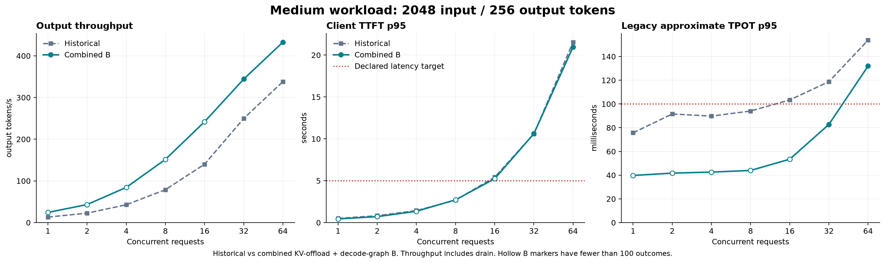
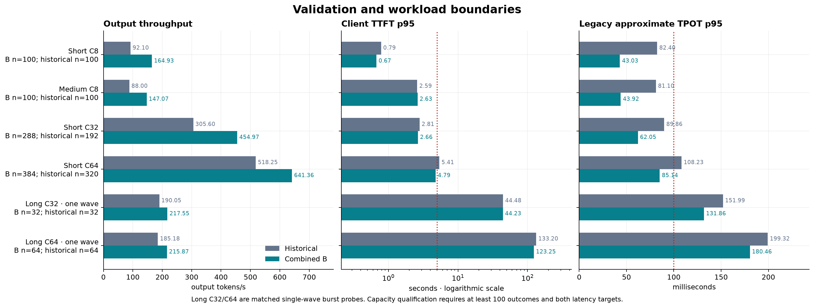
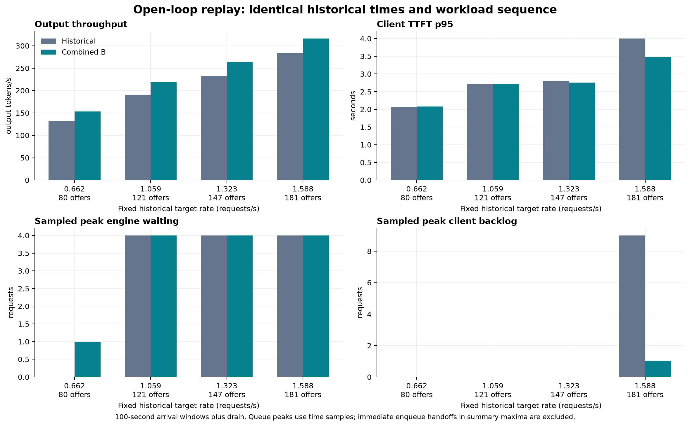
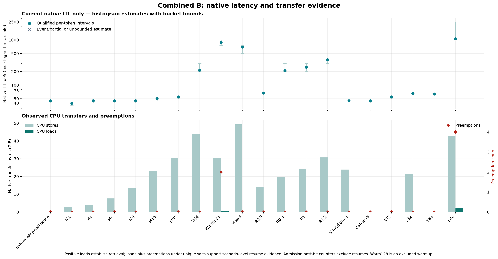

# Combined capacity results — November 13, 2026

All **29 canonical cases / 2,583 benchmark request outcomes succeeded**. The excluded observer-disable flush also passed its scored correctness check. All **555,241 native ITL intervals** match the successful output-token interval counts.

The combined KV-offload/decode-graph B configuration was run against the frozen historical workload plan. The historical arm was not rerun. These are operational comparisons across runs; they do not isolate the contribution of either feature.

| Highest tested passing concurrency | Historical | Combined B |
| --- | ---: | ---: |
| Short 512/128 | 32 | **64** |
| Medium 2048/256 | 8 | **8** |
| Common tested short/medium envelope | 8 | **8** |

A passing result requires at least 100 outcomes, at least 99% success, client TTFT p95 ≤5 s and legacy approximate TPOT p95 ≤100 ms. Every scheduled outcome remains in the success denominator; latency quantiles use successful requests. The private base-text engine was measured, with the public gateway bypassed.

Medium C16 had only 96 outcomes and TTFT p95 5.2424 s, so its faster decode does not qualify it as higher capacity. C128 was an excluded warmup; no steady C128/C256 capacity was measured. Long C32/C64 were exact single-wave bursts, with only 32/64 outcomes.

## Matched historical comparison

| Case | B outcomes | Output tok/s historical → B | B throughput change | Client TTFT p95 s historical → B | Approx. TPOT p95 ms historical → B |
| --- | ---: | ---: | ---: | ---: | ---: |
| validate-short-8 | 100 | 92.10 → 164.93 | +79.1% | 0.79 → 0.67 | 82.40 → 43.03 |
| validate-medium-8 | 100 | 88.00 → 147.07 | +67.1% | 2.59 → 2.63 | 81.10 → 43.92 |
| medium-sweep-16 | 96 | 140.11 → 241.94 | +72.7% | 5.43 → 5.24 | 103.37 → 53.44 |
| medium-sweep-64 | 184 | 338.12 → 432.82 | +28.0% | 21.53 → 20.97 | 153.78 → 131.98 |
| short-boundary-32 | 288 | 305.60 → 454.97 | +48.9% | 2.81 → 2.66 | 89.86 → 62.05 |
| short-boundary-64 | 384 | 518.25 → 641.36 | +23.8% | 5.41 → 4.79 | 108.23 → 85.14 |
| long-boundary-32 | 32 | 190.05 → 217.55 | +14.5% | 44.48 → 44.23 | 151.99 → 131.86 |
| long-boundary-64 | 64 | 185.18 → 215.87 | +16.6% | 133.20 → 123.25 | 199.32 → 180.46 |

Throughput includes scenario drain. Closed-loop runs use the same arrival windows and refill controls; faster runs can therefore complete more requests. All four open-loop runs replay the exact historical request IDs, arrival offsets and workload order: 80/121/147/181 offers. Queue plots compare time-sampled peaks, excluding immediate enqueue handoffs in summary maxima.

## New native ITL measurements

Native server ITL is distinct from historical approximate client TPOT. Native quantiles weigh intervals; approximate TPOT first averages each request and then takes request quantiles. No historical server-ITL improvement is claimed. Quantile estimates retain their containing bucket bounds in the JSON and chart.

| Case | Mean ms | Native p50 ms | Native p95 ms | Native p99 ms | Intervals >1 s |
| --- | ---: | ---: | ---: | ---: | ---: |
| validate-medium-8 | 43.27 | 42.51 | 44.79 | 44.99 | 0/25500 (0.000%) |
| short-boundary-64 | 75.17 | 57.73 | 63.42 | 856.55 | 393/48768 (0.806%) |
| warm-shape-128 | 146.32 | 81.87 | 884.09 | 2161.64 | 1447/32640 (4.433%) |
| long-boundary-64 | 137.28 | 71.19 | 1057.28 | 2213.58 | 1700/32704 (5.198%) |

Long C64 native p95/p99 estimates lie in the coarse **1000–2500 ms** bucket. Short C64 passes the declared client targets, but its 393 intervals above one second show that this does not establish an interval-tail guarantee. Individual stalls were not traced to requests or causes.

## Replay and CPU retrieval evidence

The first three already-excluded warmups recorded request-time native replay deltas **254/510/1022**. A scored flush disabled the observer before measured cases. Later native telemetry observed FULL dispatch at padded sizes **1,2,4,8,16,32,64,128**; capturing 256 does not establish actual 256 execution.

| Case | Preemptions | Actual CPU load bytes |
| --- | ---: | ---: |
| Warm C128 (excluded) | 2 | 513,409,024 |
| Long C64 single wave | 4 | 2,670,985,216 |

Positive completed CPU loads establish retrieval. Loads plus preemptions under unique request salts provide scenario-level resume evidence, without per-request attribution or an isolated causal latency benefit. The prompt host-hit counter can remain zero: preempted resumes are recorded separately from admission hit-by-source metrics. See the pinned [prefix statistics implementation](https://github.com/vllm-project/vllm/blob/v0.32.0/vllm/v1/metrics/stats.py#L126-L158) and [admission metric definition](https://github.com/vllm-project/vllm/blob/v0.32.0/vllm/v1/metrics/loggers.py#L719-L727).

CPU usage/read/write gauges measure active transfer pins and unfinished transfers, rather than retained cache occupancy. Transfer bytes are cumulative movement. GPU busy, memory-controller busy, power and clock samples are resource context; unavailable SM-active/DRAM-active profiling counters are not inferred. Historical exact GPU cache allocation was not recorded, so equal pool capacity is not asserted.

## Charts and reuse

[All-case aggregate JSON](COMBINED-CAPACITY-RESULTS-2026-11-13.json). Raw numerical evidence and dashboard screenshots remain in the local report package/gallery; private controls and screenshots are not published.

Reuse the existing [protocol](COMBINED-CAPACITY-BENCHMARK.md), canonical plan and bundle builder. Refresh the enabled production snapshot and temporary run/lease, verify unchanged source hashes and check only changed startup/manifest parts while retaining the fresh snapshot, startup contract and watchdog checks, then run the unchanged plan and restore production before reporting. Keep screenshot capture and analysis separate from the load loop.

Restoration ordering: check configuration/service health, run one required base smoke to initialize lazy CPU-transfer metric labels, then wait for publication and all five idle queue/transfer gauges before completing the idle receipt. Do not move this restoration smoke before canonical cold warm-short.

Production was restored to the enabled two-sequence profile with native CPU KV offload and decode graphs [1,2]. Independent health/configuration checks passed and the temporary helpers exited. No gateway quota change follows from this engine test.
