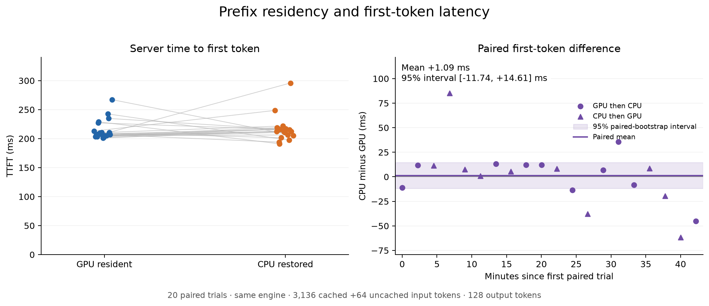
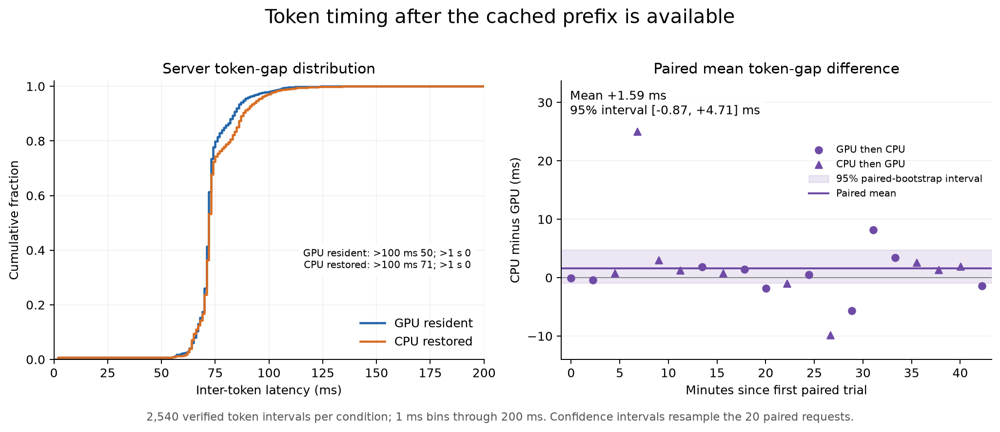

# Controlled KV residency results — November 12, 2026

**CPU KV restoration worked: all 20 paired trials passed the exact residency and
known-answer gates.** Server TTFT averaged 215.02 ms
with GPU residency and 216.10 ms after CPU restoration.
The paired mean difference was +1.09 ms
(95% paired-bootstrap interval [-11.74, +14.61] ms). Mean ITL differed by
+1.59 ms (interval [-0.87, +4.71] ms).
Both intervals include zero. This run does not resolve a mean penalty or
demonstrate equivalence. Original production configuration, service, quotas, streams and cleanup are fully verified.

Both conditions used the **same engine with native offloading enabled**. The
comparison changes prefix residency, not whether offloading is enabled.

## Results

|Metric|GPU resident|CPU restored|
|---|---:|---:|
|Mean server TTFT (ms)|215.02|216.10|
|Mean loopback first-text TTFT (ms)|222.58|223.57|
|Mean server ITL (ms)|72.58|74.17|
|ITL p50 estimate (enclosing bin), ms|71.43 (71–72)|71.80 (71–72)|
|ITL p95 estimate (enclosing bin), ms|88.21 (88–89)|94.53 (94–95)|
|ITL p99 estimate (enclosing bin), ms|104.92 (104–105)|109.20 (109–110)|
|Intervals >100 ms|50/2540|71/2540|
|Intervals >1 s|0/2540|0/2540|

The paired server-TTFT difference had median
+7.17 ms and range
[-61.65, +85.08] ms.
The paired mean-ITL difference had median +1.01 ms
and range [-9.83, +24.98] ms.
All qualified timing observations are retained; none were trimmed or rerun for
being slow. Quantiles are histogram estimates, shown as their enclosing 1 ms bins.

## Variation, order and uncertainty

Each confidence interval uses 20,000 seeded percentile-bootstrap resamples of
the 20 paired request trials. The 127 token intervals inside a response are
correlated observations, not independent resampling units. Seed: 20261112.

|Order|Pairs|Mean CPU−GPU TTFT (ms)|Mean CPU−GPU ITL (ms)|
|---|---:|---:|---:|
|GPU→CPU|10|+1.37|+0.60|
|CPU→GPU|10|+0.81|+2.58|

Chronological sensitivity is substantial: first-ten versus last-ten paired TTFT
differences were +14.81 ms and
-12.63 ms; corresponding mean-ITL
differences were +3.18 ms and
+0.00 ms. The plots preserve the time
sequence and order markers. These observations limit a precise stationary
overhead estimate. The ITL variation is not automatically attributable to CPU
restoration: transfer completed before decode, measured requests stored no CPU
data, and no preemptions occurred.

## What was actually restored

Each CPU request loaded **359,464,960 bytes (342.8125 MiB)** and counted 3136 host-hit
tokens with 0 device-hit tokens. GPU-resident requests counted 3136 device-hit
tokens with 0 host hits and 0 CPU-load bytes. Every measured target computed only
the identical 64-token suffix, generated 128 tokens, and recorded exactly 127 server
ITL observations. Known-answer checks passed. All 22-filler batches had zero CPU
store/load bytes, so eviction traffic did not replace the target in the host tier.

The payload matches four attention pages and all three recurrent groups:

- Attention: 4 pages × 16 layers × 3,211,264 bytes = 205,520,896 bytes.
- Recurrent state: 3 checkpoints × 16 layers × 3,207,168 bytes = 153,944,064 bytes.
- Total: 359,464,960 bytes; GPU page padding is not copied.

Completed CUDA load time averaged
7.356 ms per restored request.
This is supporting copy-time evidence; it excludes broader lookup/scheduling
work and is not total TTFT or total PCIe utilization.

## Controlled configuration and protocol

Existing Qwen3.8-27B BF16, revision `1d4bf0f2ff6012fd82039f2fa52739d0dd7c60c0`, vLLM
0.32.0, torch 2.13.0+cu130, transformers
5.19.0; exact image digest is in the numeric report.
One engine was started and kept throughout both residency conditions.

GPU KV budget 4 GiB resolved to 83 blocks / 4,264,558,592 bytes. Native CPU budget 8 GiB
resolved to 167 chunks / 8,580,497,408 bytes. Three Mamba groups and one
full-attention group were registered in both store and load handlers, each with
16 layer references. Cache/hash alignment 784; layout LBNHC. Eager execution,
prefix caching, aligned Mamba mode, hybrid cache manager, loaded LoRA/vision
allocation, context 40960 and max sequences 2 were retained. Weight offload stayed 0.

The request is exactly 3200 input IDs: 3136 reusable-prefix IDs plus an identical
64-token uncached suffix, then 128 forced output tokens. Temperature 0, thinking
off, base alias only. Each trial uses a fresh salt shared by its prime and both
measurements; filler salts/content are distinct. Targets cap offload at 3136;
fillers cap it at 0. Twenty-two sequential 3200/1 fillers evict the 83-block GPU pool.
Residency is accepted from actual counters, not from the eviction estimate.

A complete warm pair is excluded. The 20 measured pairs use seeded balanced
order, 10 GPU→CPU and 10 CPU→GPU. Queues and active transfers must be zero; counters
must finalize and remain stable for 10 s plus 1 quiet second. There is no overlapping
inference traffic. Every timed interval has exactly one finished request, 3200
prompt tokens, 64 computed prefill tokens, 128 output tokens and 127 ITL observations.
The server histogram therefore qualifies as per-token timing for these requests;
client content-chunk gaps remain separate.

All 40 measured targets, 21 primes, 21 filler batches and the warm pair passed their
gates: 525 successful HTTP requests in total, including 440 measured-setup fillers
and 22 warmup fillers. No rejected attempts, controller retries or preemptions.
Prompts, generated text and credentials are absent from public artifacts.

## Individual paired results

All times are milliseconds. ITL columns are each response's 127-interval mean.

|Trial|Order|GPU TTFT|CPU TTFT|CPU−GPU TTFT|GPU mean ITL|CPU mean ITL|
|---:|---|---:|---:|---:|---:|---:|
|1|GPU→CPU|227.13|216.01|-11.12|72.91|72.86|
|2|GPU→CPU|205.25|216.90|+11.65|77.11|76.73|
|3|CPU→GPU|210.43|221.77|+11.34|74.54|75.29|
|4|CPU→GPU|210.84|295.92|+85.08|72.10|97.09|
|5|CPU→GPU|208.26|215.77|+7.51|69.09|72.13|
|6|CPU→GPU|205.47|206.25|+0.78|72.01|73.28|
|7|GPU→CPU|205.56|218.82|+13.26|71.06|72.92|
|8|CPU→GPU|207.18|212.45|+5.27|71.61|72.36|
|9|GPU→CPU|201.21|213.27|+12.06|70.21|71.66|
|10|GPU→CPU|203.74|216.03|+12.29|74.51|72.65|
|11|CPU→GPU|202.49|210.83|+8.35|70.04|69.09|
|12|GPU→CPU|207.46|193.96|-13.50|71.78|72.28|
|13|CPU→GPU|228.98|191.09|-37.89|79.93|70.10|
|14|GPU→CPU|205.23|212.05|+6.82|75.65|69.99|
|15|GPU→CPU|213.01|248.66|+35.65|75.61|83.78|
|16|GPU→CPU|209.83|201.63|-8.20|71.45|74.89|
|17|CPU→GPU|203.68|212.42|+8.74|70.00|72.56|
|18|CPU→GPU|234.85|215.39|-19.46|73.99|75.30|
|19|CPU→GPU|267.13|205.48|-61.65|69.57|71.49|
|20|GPU→CPU|242.56|197.37|-45.20|68.34|66.88|

## Resources, restoration and validation

The cgroup memory peak was 66.41 GiB against
a 175.09 GiB limit; swap and OOM counters remained 0. Before the original reload,
an independent check found no vLLM/controller/GPU compute processes and confirmed
full CPU-buffer/shared-memory reclamation. Numeric artifacts and private
logs/source were backed up before the container restart.

Original pod args were restored at 2026-11-12T23:23:07Z.
The independent watchdog retained its original fixed restore trigger
2026-11-13T00:50:32Z and exclusive end
2026-11-13T01:20:32Z; neither was extended.
Original production configuration, service, quotas, streams and cleanup are fully verified.

Final verification confirmed exact original model arguments, max sequences 2,
context 40960, global admission 2 active / 6 waiting and per-user limits
1 active / 1 waiting / 6 per minute. Base and adapter streams passed; model and
gateway queues were empty, metrics and GPU exporter were healthy, and no
benchmark processes remained. Shared-memory availability returned exactly to
93,999,996,928 bytes. The owned temporary directory was absent after reload;
the global model volume was untouched. The external watchdog was disarmed only
after these checks passed.

Local tests: 19 focused tests plus 16 existing benchmark tests passed.
Tooling commit: `8f502ea115c4a450e0ed0cab7b2365f8cf64b57e`.
[Full image CI passed](https://github.com/alstomli/llm-inference-server/actions/runs/43318481222).
Both the source and the live counter/geometry audit were independently reviewed.

## Artifacts and scope

- [Numeric report](KV-RESIDENCY-RESULTS-2026-11-12.json).
- [Raw numerical ZIP](assets/qwen-kv-residency-2026-11-12-f3c8-numerical.zip) (215,555 bytes): 40 request rows, raw per-request histogram/counter deltas, prime/filler/warmup gates, source/layout hashes and event/resource timelines.
- ZIP SHA256: `eca9f6964d8145d2ca09ff0201dbbb6f6885df3e82e9f7511adf86f929a032f3`.
- [Protocol](KV-RESIDENCY-EXPERIMENT.md).

This is a controlled residency diagnostic with deliberately small 4/8 GiB cache
budgets and a synthetic base-text workload. It measures neither feature-on/off
overhead nor production capacity, concurrent traffic, decode preemption or image
KV behavior. The known-answer checks validate this workload; they are not a
general model-quality evaluation. Original production offloading remains disabled.
